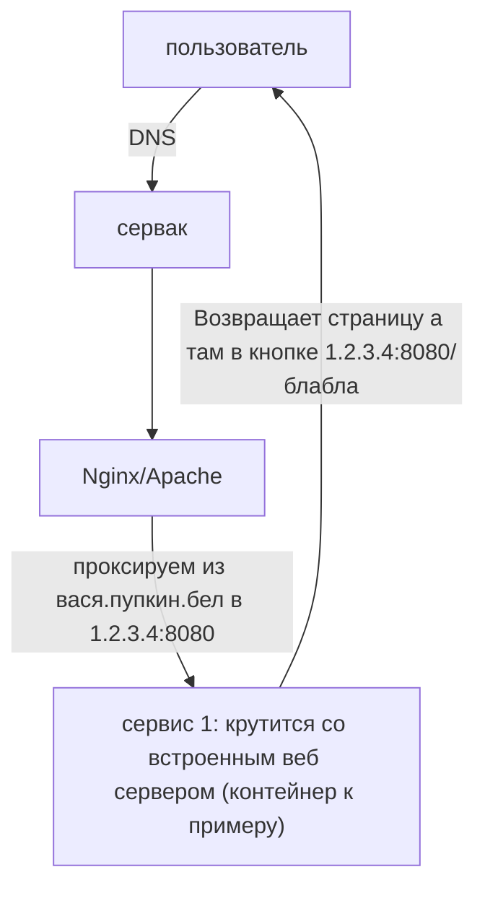

---
{"dg-publish":true,"permalink":"/public/posts/post0/","title":"На захосченом сайте \"example.com\" кнопка с ссылкой \"< local hostname >/< url >\". А как? [[post0|Read]]","tags":["blog","DevOps","nginx"],"dg-note-properties":{"title":"На захосченом сайте \"example.com\" кнопка с ссылкой \"< local hostname >/< url >\". А как? [[post0|Read]]","img":"https://i.imgur.com/axuKWSS.png","tags":["blog","DevOps","nginx"]}}
---

# Локальные ссылки в сервисе при хостинге и проксировании
## Описание проблемы:

Хосчу сервис с использованием прокси сервера и получаю вот ситуацию как на схеме ниже.



С проблемой столкнулся несколько раз и спрашивал даже у человека, который в отличие от меня девопсоом работает, а не как я балуюсь. 

Попытка как то редиректить - смерть. Чаще всего это приводит к бесконечным редиректам. Или ссылка начнёт наслаиваться до некорректности. По крайней мере у меня не получилось. Если что [[Public/Index#Evgen Buiko\|пишите]]. Но решение нашлось куда топорнее
## Решение:

### 1. Nginx sub_filter или его аналог в Apache
Штука до нельзя простая от того и рабочая - парсит контент страницы подменяя подстроку 1 на подстроку 2. 

> [!warning]  Однако
> Вытекающий из принципа работы команды минус: данный метод требует убрать компрессию

Пример:

```nginx
location ... {
		...
	proxy_set_header Accept-Encoding ""; 
	# Fix direct links  
	sub_filter "1.2.3.4:8080/" "вася.пупкин.бел/";  
	sub_filter_once off;
}
```
Как я понял это должно быть прописано в самом конце. Но это не точно)
### 2. Сделать нормально

Если вы оказались здесь то смею предположить что вам ситуация по другому сделать не распологает но мне лично сказали сделай проще и не проксируй на том же уровне/хосте что и сервис. К примеру организовать это на домене 

Для контекста в моём частном случае сервисов что я хостил было 2 на том же серваке что и Nginx: 
1. Gitlab. Целую руки разработчиков. С ним всё норм и он под такие сценарии настраивается просто из UI
2. Open project в docker контейнере. Вот тут то и было всё выше описанное. Впринципе с учётом того что это такое то и не удивительно[^1]. Пытались и по документации мало известные аргументы юзать и даже в контейнер лезли. Однако всё было зря ибо заглянули в исходники страницы а там чёрным по белому на js-е редирект по главной ссылке хостингга

Так что считаю 1-ый способ вполне легальный ибо на криворуких надеяться не приходится

[[Public/Index\|Главная страница]]

[^1]: Экскурс в историю. Open Project не является самостоятельным баг трекер проектом. Ребята в 2010-ые взяли open-source проект Redmine, прирастили ангуляр js и вагон написанных на js плагинов, наняли пару туш для сапорта и начали это продавать. Но справедливости ради сохранились они мне кажется  лучше конкурентов (RedmineUp, ChillProject )